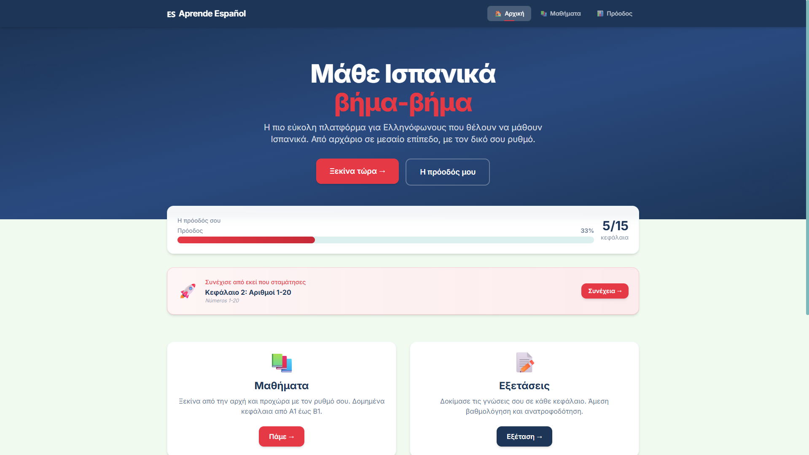
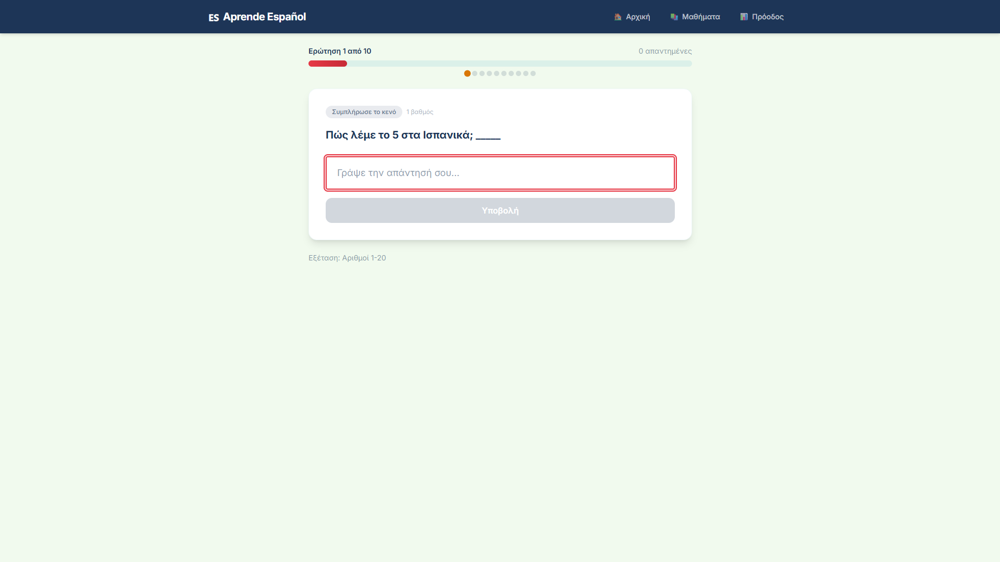
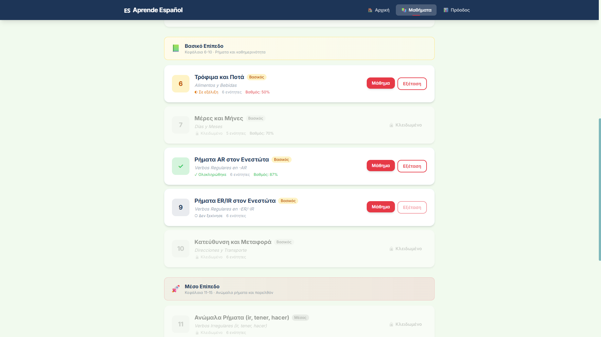
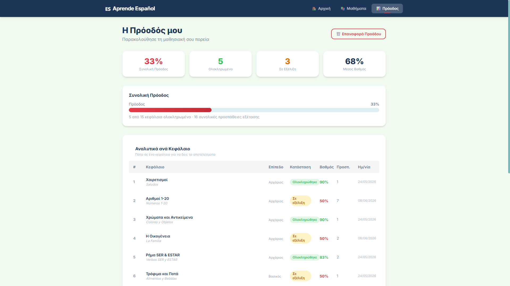
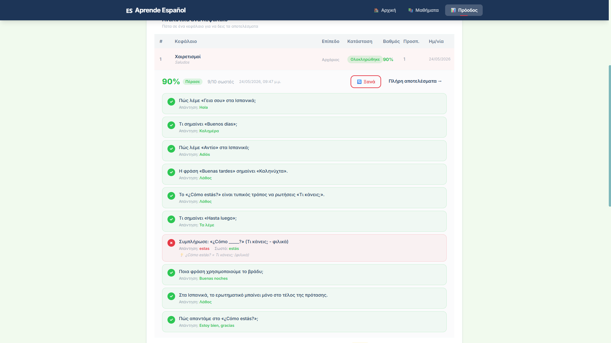

# Spanish Learning Platform

A full-stack e-commerce application built with Spring Boot and a modern frontend. The project is fully containerized using Docker and designed to be straightforward to spin up locally or on any server.

## Contributors

- **Aggelos Ladas** (Backend) - [](https://www.aggelosladas.com) [](https://www.linkedin.com/in/aggelos-ladas-9057b1196/)
- **Stefanos Souroullas** (Frontend)

An interactive Spanish learning platform built for Greek speakers. Learn Spanish through structured chapters, practice with exams, and track your progress as you go.

## Screenshots

### Home


### Lessons
Browse the available chapters and work through the material at your own pace.



### Exams
Practice what you've learned with chapter-based questions and exercises.



### Progress
Keep track of your completed chapters, exam scores, and learning progress.



### Exam Results
Review your answers, check your score, and see where you made mistakes.



## Features

- **Structured lessons:** Learn Spanish through organized chapters.
- **Interactive exams:** Test your understanding with chapter-specific exercises.
- **Progress tracking:** Keep track of completed chapters and exam performance.
- **Answer review:** See your results and review incorrect answers.
- **Resume learning:** Return to your learning progress instead of starting over.
- **Greek interface:** Learn Spanish with explanations and navigation designed for Greek speakers.

## Tech Stack

- **Frontend:** React, Vite, Nginx
- **Backend:** Python, FastAPI, Uvicorn
- **Deployment:** Docker, Docker Compose
- **Database:** SQLite

## Getting Started

The easiest way to run the application locally is with Docker Compose.

### Prerequisites

- [Git](https://git-scm.com/)
- [Docker Desktop](https://www.docker.com/products/docker-desktop/) or Docker Engine with Docker Compose

### 1. Clone the repository

```bash
git clone https://github.com/AggelosLadas/Spanish-Learning-Platform.git
cd Spanish-Learning-Platform
```

### 2. Start the application

```bash
docker compose up --build
```

Docker Compose will build the frontend and backend images and start the required containers.

### 3. Open the application

Once the containers are running, open:

**http://localhost:8080**

The frontend is exposed on port `8080`, while the backend uses port `8000` inside the Docker setup.

If the application doesn't load, check the container status:

```bash
docker compose ps
```

View the logs if needed:

```bash
docker compose logs -f
```

### 4. Stop the application

Press `Ctrl+C` in the terminal running Compose, then run:

```bash
docker compose down
```

To start the application again later:

```bash
docker compose up -d
```

To rebuild the images after making changes:

```bash
docker compose up -d --build
```

**Note:** Database persistence depends on the configured Docker volumes and database path. Avoid removing volumes if you want to preserve existing data.

## Project Structure

```text
Spanish-Learning-Platform/
├── Images/
│   ├── Screenshot_1.png
│   ├── Screenshot_2.png
│   ├── Screenshot_3.png
│   ├── Screenshot_4.png
│   └── Screenshot_5.png
├── backend/
├── frontend/
├── docker-compose.yml
├── LICENSE.txt
└── README.md
```

## License

This project is licensed under the [MIT License](LICENSE.txt).
